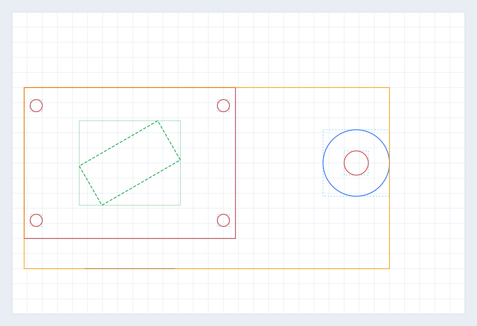

# LaserCut Studio v1.0

Браузерный векторный редактор для лазерной резки: чертёж в **миллиметрах 1:1**, DXF/SVG,
узлы, булевы операции, раскладка деталей и проверка макета перед резкой.
Одна HTML-страница, без сервера, без интернета, без регистрации — открывается двойным кликом.

- **Живая версия:** https://pavelb-coder.github.io/sim-2d/
- **Репозиторий:** https://github.com/pavelb-coder/sim-2d
- **Локально:** http://localhost:8084



---

## Что умеет

| Блок | Состояние |
|---|---|
| Лист в мм, форматы A4/A3/300×200/400×300/600×400 и своя ширина/высота | ✅ |
| Сетка с шагом 0,5–20 мм, оси листа, зум колесом к курсору, «весь лист» | ✅ |
| Панорама (Space / средняя кнопка), координаты курсора в мм | ✅ |
| Инструменты: выбор рамкой, узлы, линия, прямоугольник, эллипс, многоугольник, звезда, текст, паз | ✅ |
| Соединение «паз — шип» (инструмент «Паз», `J`): клик по ребру — паз шириной «толщина − зазор» и глубиной в толщину, с превью под курсором | ✅ |
| Ласточкин хвост (устье шире дна) и шип-выступ (приварка наружу) — те же настройки, другой тип | ✅ |
| Живые ручки выделения: масштаб за 8 ручек (Shift — пропорционально, Alt — от центра), поворот за ручку сверху (Shift — шаг 15°) | ✅ |
| Привязки: сетка, концы и центры контуров, углы и центр листа, «Shift» — 45° | ✅ |
| Перемещение мышью, точные X/Y/W/H, поворот на любой угол | ✅ |
| Поворот на 90° и зеркало одной кнопкой | ✅ |
| Выравнивание по 6 направлениям (к листу или к выделению) и распределение по X/Y | ✅ |
| Булевы операции: сварить, вычесть, пересечь, исключить (Clipper, точность 0,1 мкм) | ✅ |
| Контур наружу/внутрь (offset) с закруглением углов | ✅ |
| Материал и рез: пресеты (фанера, МДФ, акрил, ПЭТ), толщина, ширина реза, компенсация kerf/2 по контурам слоя реза | ✅ |
| «Учесть рез в контурах» — раздувает детали и сжимает отверстия на половину реза, одним шагом undo; гравировка не меняется | ✅ |
| Компенсация реза в экспорте DXF (галочка в блоке «Материал» и в диалоге `Ctrl+E`), в том числе для дюймовых файлов | ✅ |
| PowerClip: «Поместить внутрь» (обрезка по контуру нижнего объекта) и «Извлечь содержимое» с возвратом контуров | ✅ |
| Текст по контуру: надпись идёт вдоль выделенного контура, буквы поворачиваются по касательной | ✅ |
| Заливка объекта: сплошная, линейный и радиальный градиент (экран + SVG, на DXF не влияет) | ✅ |
| Блок «Цвет» как палитра CorelDRAW: 35 образцов, клик — заливка, правый/Shift+клик — обводка, «нет цвета», смеситель HSL с полем HEX | ✅ |
| Копии рядом и по кругу, группы, порядок наложения | ✅ |
| Раскладка на листе: полочная, с зазором, отступом и поворотом на 90° | ✅ |
| Узловое редактирование: тянуть узел, двойной клик — вставить, «в кривую/в прямую», разрыв | ✅ |
| Узлы 2.0: мультивыделение (Shift, рамка), ручки Безье, гладкий / симметричный / угловой узел | ✅ |
| «В кривые» (`Ctrl+Q`, как в CorelDRAW): масштаб и поворот запекаются в контуры, дуги становятся кривыми Безье — объект правится узлами | ✅ |
| Узлы 3.0 (как в CorelDRAW): выделение и перетаскивание **сегментов** (двигаются оба узла), маркеры по типу узла — квадрат / круг / ромб | ✅ |
| Узлы 3.0: точные `X`/`Y` активного узла, сдвиг стрелками (1 / 10 / 0,1 мм), соединить, обратить направление, выровнять по X / Y | ✅ |
| Правильные фигуры: многоугольник (3–64 стороны) и звезда (3–32 луча, глубина 5–95%) | ✅ |
| Скругление и фаска углов («Углы», радиус в мм, применяется к выделению) — как в CorelDRAW | ✅ |
| Умные направляющие при перетаскивании: края и центры соседних объектов и листа, линии-подсказки | ✅ |
| Равные интервалы: прилипание по середине между соседями и на таком же расстоянии, как у других объектов | ✅ |
| Панели-докеры: секции сворачиваются кликом по заголовку, Alt+клик — аккордеон, состояние запоминается | ✅ |
| Менеджер объектов: список по Z-порядку, скрыть/показать (◉/○), заблокировать (🔒/🔓), поднять/опустить | ✅ |
| Текст в кривые (кириллица + латиница), шрифт DejaVu Sans встроен в сборку | ✅ |
| Импорт DXF: LINE, LWPOLYLINE (bulge), POLYLINE/VERTEX, CIRCLE, ARC, ELLIPSE, SPLINE, INSERT, TEXT, `$INSUNITS` | ✅ |
| Экспорт DXF: R2000 (LWPOLYLINE) и R12 (POLYLINE+VERTEX) со слоями CUT/ENGRAVE/SCORE | ✅ |
| Диалог экспорта DXF: версия, только выделенное / весь лист / все листы, мм или дюймы, точность кривых | ✅ |
| Импорт и экспорт SVG (mm, трансформации, дуги A, фигуры, viewBox) | ✅ |
| Проверка перед резкой: разомкнутый контур, нулевая длина, выход за лист, дубликаты, самопересечения | ✅ |
| Статистика: длина реза по слоям в метрах, площадь выделения | ✅ |
| Автосохранение в браузере + проект `.lcx` (скачать/открыть) | ✅ |
| Undo/redo на патчах (120 шагов), PNG-экспорт 4 px/мм | ✅ |

Проверено на реальных сценариях: сварка/вычитание пластин, контур под посадку, текст «Рез 42»,
раскладка 12 деталей, круговой импорт-экспорт DXF без потери геометрии (см. тесты).

---

## Запуск

Порт по умолчанию — **8084** (`http://localhost:8084`).

### Windows

Двойной клик по `start.bat` — проверит Node.js, поставит зависимости, соберёт и откроет браузер.

Или в PowerShell:

```powershell
npm install      # один раз
npm run build
npm run serve    # http://localhost:8084
```

Нужен Node.js 18+ ([nodejs.org](https://nodejs.org/ru), LTS). Python не требуется.

### Ubuntu / Linux / macOS

```bash
chmod +x start.sh && ./start.sh
```

Или вручную:

```bash
sudo apt update && sudo apt install -y nodejs npm   # Node.js 18+
npm install
npm run build
npm run serve            # http://localhost:8084
PORT=9000 npm run serve  # другой порт
```

Сервер `scripts/serve.mjs` — чистый Node без зависимостей, одинаково работает на Windows и Ubuntu,
слушает `0.0.0.0` (доступен с других машин: `http://<ip>:8084`).

### Просто открыть файл

`site/index.html` — полностью самодостаточная сборка (CSS, JS и шрифт внутри).
Её можно скопировать на флешку и открыть двойным кликом на любом компьютере без Node.js.

---

## Горячие клавиши

| Клавиши | Действие |
|---|---|
| `V` / `N` / `L` / `R` / `E` / `P` / `S` / `T` / `J` | выбор / узлы / линия / прямоугольник / эллипс / многоугольник / звезда / текст / паз |
| `Space` + мышь, средняя кнопка | панорама |
| Колесо | зум к курсору |
| `Ctrl+Z`, `Ctrl+Shift+Z` / `Ctrl+Y` | отменить / вернуть |
| `Ctrl+D` | дублировать |
| `Ctrl+A` | выделить всё на листе |
| `Ctrl+G` / `Ctrl+Shift+G` | сгруппировать / разгруппировать |
| `Ctrl+0` | весь лист |
| Клик по заголовку секции | свернуть / развернуть блок панели; `Alt`+клик — оставить открытым только его |
| Клик / правый клик по образцу палитры | цвет заливки / цвет обводки (как в CorelDRAW) |
| `+` / `−` | зум |
| Стрелки | сдвиг на 1 мм; с `Shift` — 10 мм; с `Ctrl` — 0,1 мм; при активном инструменте «Узлы» сдвигается выбранный узел, а не объект |
| Клик по кривой в инструменте «Узлы» | выделить сегмент; перетаскивание двигает оба его узла и сохраняет форму дуги |
| Ручки рамки | масштаб (с `Shift` — пропорционально, с `Alt` — от центра); круглая ручка сверху — поворот (с `Shift` — по 15°) |
| `Delete` | удалить выделенное или активный узел |
| `Esc` | отменить действие инструмента, снять выделение |
| `Ctrl+S` | скачать проект `.lcx` |
| `Ctrl+Q` | «В кривые»: масштаб и поворот — в контуры, дуги — в кривые Безье (в инструменте «Узлы» — сегмент в кривую) |
| `Ctrl+E` | экспорт DXF с настройками (версия, выделение, единицы, точность) |
| `Ctrl+O` | открыть файл (DXF, SVG, `.lcx`) |

Файлы можно просто перетащить в окно редактора.

---

## Проверки

```bash
npm run typecheck    # tsc --noEmit, strict
npm test             # 43 теста геометрии + 37 тестов ядра (DXF, SVG, булевы, узлы, текст, цвет)
npm run test:dom     # smoke всего приложения в jsdom (рисование, операции, диалоги, экспорт)
npm run test:build   # собранный site/index.html грузится целиком (синтаксис бандла, старт, панели)
npm run test:all     # всё вместе
```

Что покрыто тестами:

- `tests/geom.test.ts` — bbox Безье и дуг, bulge ⇄ дуга, матрицы, правки, история патчей,
  редактор узлов 3.0 (типы узлов, сдвиг сегмента, соединение, реверс, выравнивание),
  материал и компенсация реза (пресеты, рост детали и сжатие отверстий, разомкнутые контуры),
  «в кривые» (дуги → Безье с сохранением габарита, запекание матрицы),
  соединение «паз — шип» (ширина от толщины, нормаль внутрь, шип наружу, повёрнутая деталь).
- `tests/core.test.ts` — импорт/экспорт DXF (включая `$INSUNITS` в дюймах и `INSERT` блоки),
  round-trip R2000/R12 с сохранением геометрии, SVG parse/write, площади булевых операций,
  offset, валидатор, узловые правки, текст в кривых, раскладка.
- `tests/fixtures/` — эталонные файлы: `plate-r2000.dxf`, `legacy-r12.dxf`, `inches.dxf`, `plate.svg`.
- `tests/dom.test.mjs` — приложение целиком: рисование, undo/redo, панели, булевы операции,
  поворот/зеркало, раскладка, проверка, диалог текста, сборка DXF/SVG плюс статическая проверка
  собранного файла (инлайн-бандл парсится, заглушек dev-режима нет).
- `scripts/check-build-boot.mjs` — открывает `site/index.html` как обычный файл в jsdom и проверяет,
  что приложение стартует без ошибок: 9 инструментов, 17 блоков панели, демо-документ. Эту проверку
  не заменяют остальные тесты: они импортируют JS отдельно и не видят поломок инлайна.

Производительность (Node 20, ноутбук): импорт 3 000 окружностей — 68 мс, экспорт — 64 мс,
проверка — 69 мс; полилиния на 3 000 вершин — 11 мс. Рендер отделён от модели и перерисовывает
только изменившееся (сцена/оверлей), Path2D кэшируется по ссылке.

---

## Синхронизация с GitHub

Авторизация сохранена в `.env.local` (файл в `.gitignore`, в репозиторий не попадает):

```bash
npm run sync                          # авто-сообщение коммита
npm run sync -- "feat: узлы и правка"  # своё сообщение
```

`scripts/sync.mjs` делает `git add -A` → `commit` → `push` в `pavelb-coder/sim-2d` **той ветки,
в которой вы работаете**, и держит ветки в актуальном состоянии:

Порядок всегда один — **сначала `main`, потом ветка Moodle**:

| Работаете в | Что делает `npm run sync` |
|---|---|
| `main` (редактор) | 1) пушит `main` → 2) вливает его в зеркальные ветки и пушит их |
| `moodle-plugin` (плагин) | 1) подтягивает свежий `main` (и вливает в свою ветку) → 2) пушит `moodle-plugin` |

Список зеркал — `GIT_MIRROR_BRANCHES` в `.env.local` (по умолчанию `moodle-plugin`).
Правки плагина не «протекают» в `main`: он остаётся чистым редактором, а ветка плагина —
`main` + плагин. Если слияние конфликтует, уже отправленная ветка остаётся как есть,
а скрипт печатает, что нужно разрешить вручную; собственные коммиты зеркала не теряются.
Токен подставляется только в URL пуша — в `.git/config` и в историю Git он не пишется.
Если токен истёк, замените строку `GITHUB_TOKEN=` в `.env.local`.

GitHub Pages отдаёт папку `/docs` (`docs/index.html` — та же сборка, что `site/index.html`).
Если нужен деплой через Actions с прогоном типов и тестов, положите готовый
`docs/pages-workflow.yml` в `.github/workflows/pages.yml` (нужен токен со scope `workflow`)
и включите Settings → Pages → Source: **GitHub Actions**.

---

## Структура

```
src/
  core/                 # чистая логика, без DOM
    types.ts            # модель документа (мм, SubPath/Seg/Mat2x3)
    geom/               # vec, transform, bezier, arc, path, hit, nodeEdit, boolean, corners, kerf, curves, joint
    shape.ts            # генераторы фигур, uid
    doc.ts              # документ, листы, слои
    snap.ts             # привязки + кэш
    smart.ts            # умные направляющие и равные интервалы
    fill.ts             # заливка: тип, второй цвет, угол, осевая линия градиента
    color.ts            # HSL ⇄ HEX для палитры и смесителя
    textPath.ts         # текст по контуру (буквы по касательной)
    dxf/                # tokenize → import → export (R2000/R12)
    svg/                # parse, write
    text.ts             # opentype.js, шрифт в base64, текст в кривые
    validate.ts         # проверки перед резкой
    nest.ts             # полочная раскладка
    demo.ts             # демо-макет
  state/                # store, history (патчи), edits, ops (булевы, выравнивание, раскладка)
  render/               # view (мм↔px), scene, overlay, handles (ручки), path2d, theme
  tools/                # select, shape, node, text, реестр инструментов
  ui/                   # panels, panelsCollapse (докеры), palette (блок «Цвет»), dxfDialog, dialog
  index.html            # разметка интерфейса
  styles.css            # оформление
  main.ts               # сборка: канвасы, DPR, события, файлы, автосейв, горячие клавиши
tests/
  geom.test.ts          # 43 теста геометрии/истории (углы, направляющие, интервалы, ручки, узлы)
  core.test.ts          # 37 тестов ядра (DXF/SVG, булевы, текст, текст по контуру, заливка, цвет)
  fixtures/             # эталонные DXF/SVG
  dom.test.mjs          # приложение в jsdom
assets/fonts/           # DejaVuSans-subset.ttf (латиница + кириллица + №)
build.mjs               # сборка в один site/index.html (+ docs/)
scripts/serve.mjs       # статический сервер, порт 8084
scripts/sync.mjs        # commit + push с токеном из .env.local
start.bat / start.sh    # запуск в один клик (Windows / Ubuntu)
```

---

## Решения, которые уже в коде (и почему)

1. **Ось Y документа направлена вверх**, как в DXF: инверсия живёт только в `render/view.ts`,
   геометрия и инструменты про неё не знают. Поэтому DXF не «переворачивается» при импорте.
2. **Всё в миллиметрах**, без промежуточных «пикселей документа»: `$INSUNITS` пересчитывается
   один раз на входе, экспорт всегда `$INSUNITS=4`.
3. **Патчи вместо снапшотов** в истории: `{kind:'add'|'remove'|'update'|'order'}` по `id`.
   120 шагов undo не съедают память даже на 3 000 объектов.
4. **Дуги хранятся дугами** (`Seg{t:'a'}`), а не набором кубических: при экспорте они становятся
   bulge-вершинами LWPOLYLINE, при импорте — обратно в дуги. Круги уходят как `CIRCLE`.
5. **Точный bbox Безье** по корням производной — иначе объект «выделяется в пустоте».
6. **Булевы операции — Clipper** (проверенный алгоритм, масштаб 1e4 = 0,1 мкм). Результат
   замкнутый и корректный по площади, но кривые в нём заменяются полилинией — это подсказано в UI.
7. **Текст — opentype.js со встроенным шрифтом**: кириллица работает офлайн, а не «если у
   пользователя есть Arial».
8. **Умные направляющие считаются по габаритам и осям независимо**: по каждой оси берётся
   ближайший край или центр среди видимых объектов того же листа и самого листа; при равенстве
   расстояний край имеет приоритет над центром, поэтому подсказка не «прыгает».
9. **Скругление углов работает по геометрии контура, а не по «скруглённому прямоугольнику»**:
   на каждом внутреннем узле ставится дуга (касательная к обоим отрезкам) или прямой срез, радиус
   ограничивается половиной меньшего из соседних отрезков. Кривые при этом распрямляются в ломаную
   (допуск 0,05 мм) — это осознанный компромисс, он подсказан в интерфейсе.
10. **Ручки считаются в экранных пикселях, а масштаб — в мировых мм**: рамка может быть
    перевёрнутой (ось Y вверх), а ручки обязаны быть «слева/справа/сверху/снизу». Общий модуль
    `render/handles.ts` используют и оверлей, и инструмент выбора — попадание мышью и картинка
    не могут разъехаться.
11. **PowerClip — деструктивная обрезка с памятью об исходнике.** Геометрия пересекается
    с контуром контейнера (Clipper), а прежние контуры и матрица складываются в `obj.clip`:
    «Извлечь содержимое» возвращает их байт в байт и убирает контейнер. Так резка всегда видит
    готовые замкнутые контуры — ничего не нужно пересекать на этапе экспорта.
12. **Заливка и градиент — только оформление**: в DXF они не пишутся (лазер режет контур),
    в SVG уходят как `<linearGradient>`/`<radialGradient>`; геометрия от них не зависит.
13. **Текст по контуру раскладывается по одному символу**: нужна ширина каждого глифа, чтобы
    поставить его в точку с накопленной длиной дуги; кернинг пары при этом теряется.
14. **Сборка подставляет бандл только функцией-заменителем.** `String.replace` со строкой
    раскрывает `$&`, `$1`, `` $` `` — а такие последовательности есть в минифицированном коде.
    Один раз из-за этого в JS попала сама строка-заглушка тега script, и файл перестал
    исполняться; теперь `build.mjs` проверяет, что бандл попал в HTML байт в байт.
15. **Шрифт, CSS и JS инлайнятся в один HTML** — редактор запускается из файла и в песочницах,
   где внешние запросы запрещены.

---

## Известные ограничения

- Булевы операции и offset возвращают ломаные: исходные Безье в результате не сохраняются.
- Раскладка полочная (по габариту), без поворота на произвольный угол и без учёта вложенности
  контуров; для сложных деталей нужна ручная доводка мышью.
- Встроенный шрифт — DejaVu Sans (латиница, кириллица, цифры, №). Других шрифтов и выбора
  гарнитуры пока нет; кривые текста можно дальше править узлами.
- DXF-импорт понимает основные сущности; `HATCH`, размеры и таблицы игнорируются
  (обычно для резки они не нужны).
- Ручки масштабируют и поворачивают рамку целиком: тянуть за ручку отдельный узел нельзя (для этого
  инструмент «Узлы»). Поворот всегда вокруг центра рамки.
- Текст по контуру расставляет символы без кернинга и не умеет «переворачиваться» на внутреннюю
  сторону контура; надпись длиннее контура даёт предупреждение, хвост выходит за конец.
- Заливка не влияет на резку и не пишется в DXF; в SVG градиент задаётся двумя цветами.
- Скругление/фаска углов заменяет Безье ломаной: после операции исходные кривые не восстанавливаются
  (Ctrl+Z возвращает их, но повторное применение к кривым снова их распрямит).
- Умные направляющие не учитывают зазоры и «равные интервалы» между объектами (это следующая ступень:
  как в CorelDRAW, с подсказками расстояний).
- Список объектов плоский: группы и слои отображаются как один объект/плоский перечень, без дерева.
- Проверка геометрии — эвристическая: дубликаты и самопересечения ищутся по допуску 0,01 мм.
